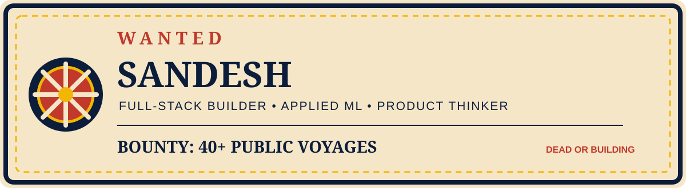

  <picture>
    <source media="(prefers-color-scheme: dark)" srcset="assets/wanted-poster-dark.svg">
    <source media="(prefers-color-scheme: light)" srcset="assets/wanted-poster-light.svg">
    
  </picture>

  
  
  

  

  

## Captain's Log

I’m **Sandesh**, a B.Tech CSE student at **KIIT Bhubaneswar** building end-to-end products with a bias toward practical impact. My north star is socially useful technology for rural India, especially in **agriculture and healthcare**.

I enjoy owning the whole voyage: product flow, responsive interfaces, APIs, data models, ML experiments, tests, and the README that helps someone else run the work. My public repos currently span React, Next.js, Django, Node.js, PostgreSQL, MongoDB, computer vision, and reinforcement learning.

**Current bounty:** 40+ public repositories charted — measured in shipped experiments, not salary or hype.

## Next Island on the Grand Line

- Building and refining **MESY**, a farm-operations platform for crop decisions, weather, soil, pest, and irrigation workflows.
- Improving reproducibility and evaluation in a **PPO-based zombie-survival simulation**.
- Preparing for **top product-company SDE roles** through stronger systems, data structures, and product engineering fundamentals.

## My Devil Fruit

### Human-centred full-stack problem solving

My strongest area is taking an ambiguous workflow and turning it into a complete, explainable system: a useful UI, a reliable API, a sensible data model, and honest boundaries around ML or provider-dependent features.

  
  
  

## My Crew

| Crew role | Tools I use |
| --- | --- |
| **Languages** | Python, JavaScript, TypeScript, SQL, HTML, CSS |
| **Frontend** | React, Next.js, Vite, Tailwind CSS, React Router, Recharts |
| **Backend** | Django, Django REST Framework, Node.js, Express, REST APIs |
| **ML & data** | OpenCV, scikit-learn, XGBoost, Gymnasium, Stable-Baselines3, PPO, Pandas, NumPy |
| **Databases** | PostgreSQL, MongoDB, local JSON stores |
| **Tools & delivery** | Git, GitHub Actions, pytest, npm, Vercel, Gunicorn, Linux |

## Treasure Map — featured voyages

| Voyage | Problem and engineering focus | Stack |
| --- | --- | --- |
| [MESY — Smart Agriculture AI Platform](https://github.com/Sandeshkumar0/smart_agri) | A farmer-focused dashboard bringing field records, weather, crop analytics, pest scanning, soil insights, market data, and advisories into one workflow. | React, Vite, Node.js, Express, PostgreSQL, OpenCV, Python |
| **MESYS Health** | A rural healthcare web-app concept focused on making essential health workflows easier to access. The public repository or live URL is not published yet. | Web app stack to be documented |
| [Facial Expression Recognition](https://github.com/Sandeshkumar0/face_expression_detection) | A custom CNN experiment classifying seven emotion classes, built during a Tata Steel internship. | Python, Jupyter, CNN, computer vision |
| [Smart Irrigation Prediction](https://github.com/Sandeshkumar0/smart_irrigation) | Predicts water requirement from crop, soil, region, temperature, and weather inputs, then applies a transparent motor ON/OFF rule. | Python, Flask, scikit-learn, XGBoost, Pandas |
| [Zombie Survival RL](https://github.com/Sandeshkumar0/reinforcement_learning) | A reproducible simulation for testing cooperative PPO policies, event-based rewards, seeded evaluation, and deterministic regression tests. | Python, Gymnasium, Stable-Baselines3, PPO, pytest |

## Bounty Board

  
  

  

  

## Road to Laugh Tale

- Strengthen data structures, algorithms, operating systems, databases, and distributed-systems fundamentals.
- Turn MESY and MESYS Health into clearer, deployable products with measurable user outcomes.
- Keep ML work reproducible: versioned data, deterministic evaluation, useful baselines, and transparent limitations.

## Contribution voyage

  

  

  “I’m going to be the King of Developers.”

